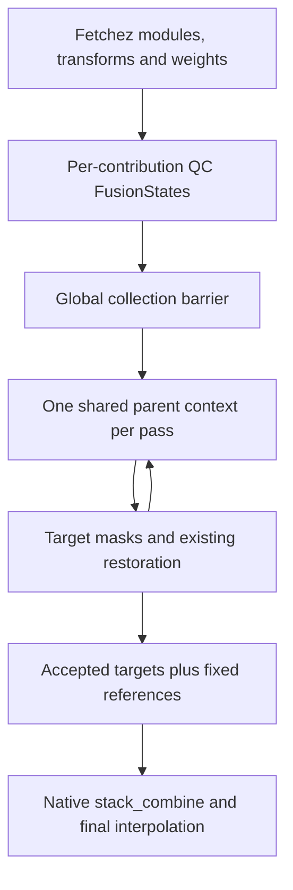

# Architecture and remaining work

## Where Stack QC belongs

The inspected Fetchez `core.run_fetchez` already exhausts source streams,
retains `(owner_module, entry)` tuples, completes module collection hooks, then
runs global collection hooks in recipe order. This is the needed barrier: **all
selected input data are materialized before QC; final stacking/interpolation
happens after QC.** No new pipeline executor or Fetchez fork is necessary.

The working context is the union of target contributions and extra references.
The complete final DEM may also include explicitly unselected modules; these
remain normal side-stack passthrough. If every data source must influence QC,
select each as either a target or extra reference. Interpolation tiers are context
products, never new independent survey votes.

`modules: [mbdb, csb]` targets both modules. `add_ref_modules: [dav, nos_hydro]`
adds those sources to the context without filtering them. The targets are already
included, so the reference list must not repeat them. Use the same selectors,
resolutions and CRS on `stack_qc_grid` and `stack_qc`. Grid creation is required
for every joint participant, even at equal QC/final resolution. Do not put
`side_stack_check` before joint grid production: a side-stack hit can consume the
point stream before the fresh grid producer sees it.

## Pass semantics and weights

One pass reads the same parent masks and weighted working surface for all target
sources. It writes separate target masks; only after that pass are changed native
blocks rebuilt for the next pass. References stay fixed throughout rejection,
restoration and cleanup and receive no masks. This removes the order dependence
of fully filtering A, then using its final state while filtering B. It also avoids
building the same unfiltered context independently for every module.

One joint invocation shares method, grid, thresholds and pass policy across its
targets: Geometry5 uses five forced passes; Connectivity2 uses two forced passes.
Different per-module algorithms/pass limits in one call are not implemented.
Sequential module-specific QC invocations are not an equivalent replacement.

The source stream's existing seven-band weighted FusionState enters MultiStack
unchanged. Module weights affect the working terrain and native within-survey
weighted pooling. They do not multiply independent-survey vote counts or alter
scientific thresholds. A known acquisition group is one survey even if files or
providers split it; unidentified sources retain the frozen pooled-context
semantics. Module identity is provenance, not an independent survey vote.

Reference-only means unfiltered and still retained for final assembly. Finer
reference grids are aggregated by summing the original native statistics, without
interpolation or dropping observations. This is a new optional input layout;
historical coarse NOS grids are not asserted byte-identical to it.

Repeated instances of a provider use ordinary recipe-style selectors, for example
`{module: dav, args: {survey_id: reference_2024}}`. Selector args must correspond
to actual module arguments; no alias/provider registry is added. Source IDs bind
native contribution identity and exact new QC-grid content. A JSON contribution
manifest records role, module, invocation ID, group, weight, source hash/path,
accepted output, and target mask. The optional standard `provenance` hook can
publish pixel-level products. Owners remain original, including in downstream
collection hooks. Joint final reduction is source-identity ordered; legacy
single-module final reduction keeps the frozen order.

## Engineering changes and ownership

| Existing component | Change |
| --- | --- |
| Globato `StackQCGrid.run` | Grid selected target/reference union; private joint paths; weight/invocation identity; current stream materialization |
| Globato `StackQC.run` | Split roles, validate common region/CRS and stream success, invoke preparation once |
| `preparation.collect_sources/cache_key/prepare` | Per-owner weights/IDs; exact joint content identity; role-sensitive result key; fixed-reference publication; contribution receipt |
| `SourcePool` | Reference evidence in groups/spatial/window indexes; rejection writers still target-only |
| `WorkingSurface`, native stacking | Fixed references never require masks; existing changed-block reuse retained |
| `resampling.accepted_stream` | Reuse native aggregation with no mask for references |
| `StackCombine.run` | Propagate receipts and deterministic new-joint source ordering |
| Optional review code | Rebuild/display the actual joint context separately from production |
| Fetchez `core/recipe` | Existing collection barrier and ownership; optional IDs (#526) and final companions (#525) are separate framework contributions |

Errors fail for mixed regions/CRS, incomplete source grids, failed selected
streams, overlapping roles and repeated filtering. A requested reference with
no discovered entries produces a warning (valid for spatially absent data); the
receipt lists actual inputs, so absence is inspectable. Use fail-fast pipeline
behavior rather than ignoring collection-hook failures in production.

## Cache policy and efficiency

Existing changed-block rebuilds, source-window caching and native engines are
retained. Measure inventory, source gridding, context construction, decisions,
restoration and publication separately before optimizing. Shared contexts
remove duplicate module-level baseline/pass builds and duplicate evidence reads.
All target decisions are still required: runtime does not become independent of
the number/extent of sources.

New joint grids are materialized from current streams in private per-hook and
per-entry paths. That prevents different upstream transformations or weights of
the same raw source from overwriting one another. It also prevents trusting an
old grid merely because schema/tags match. The exact materialized contents,
contribution identities/roles/weights, science, grid, interpolation and recursive
QC-code hashes key the decision cache. Warm identical joint runs reuse filtering;
source parsing/reprojection/gridding still runs. No global cache service, mutable
shared symlinks or archive-extraction shortcuts were introduced.

The existing source-grid key cannot universally fingerprint every upstream hook,
remote datum resource and raw payload revision. Safe source-grid reuse should be
implemented in the existing Fetchez contribution/stream identity contract and
Globato side-stack validation/publication, with verified immutable payloads.
Until then, current-stream gridding is deliberate correctness work, with a disk
and I/O cost. Cross-method baseline reuse is also deferred: keep later masks and
states method-specific; never remove science settings from final-result keys.
